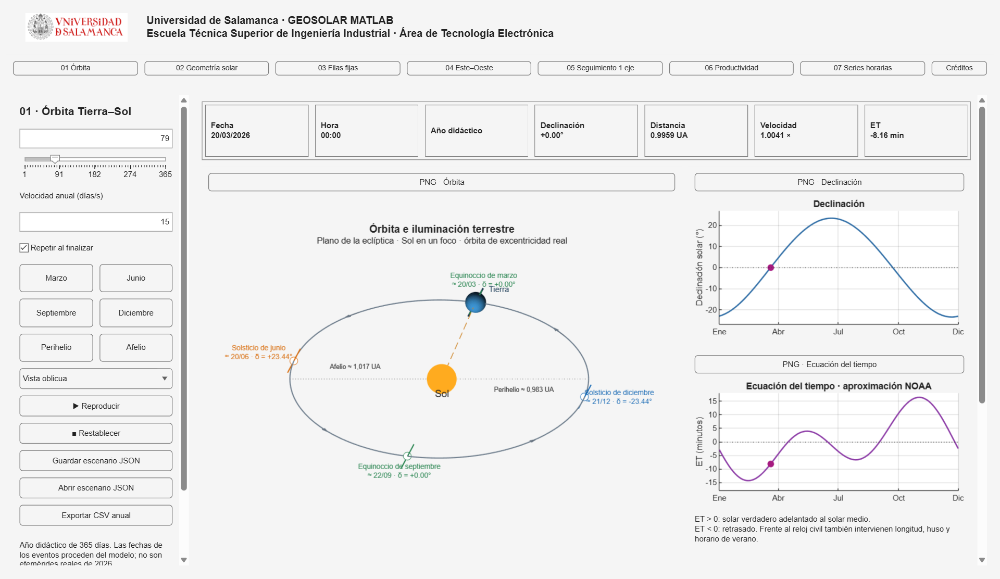

# GEOSOLAR MATLAB · Piloto 0.7

Contenedor con los siete laboratorios nativos: Órbita, Geometría solar, Filas fijas, Este–Oeste, Seguimiento 1 eje, Productividad y Series horarias. A la derecha de 07 se encuentra Créditos. La suite abre en Órbita y conserva los parámetros de cada sección al cambiar. Todos los botones están habilitados; queda la revisión docente y validación integral de la suite.

Herramienta didáctica para **Tecnología e Instalaciones Fotovoltaicas**, del Grado en Electrónica Industrial y Automática de la [Escuela Técnica Superior de Ingeniería Industrial de la Universidad de Salamanca](https://industriales.usal.es/). Autor: **Esteban Sánchez Hernández** · [ORCID](https://orcid.org/0000-0003-1341-8767).

[Licencia MIT](LICENSE) · [Créditos y atribuciones](docs/ATRIBUCIONES.md) · [Datos de ejemplo](data/README.md) · [Validación de publicación](docs/VALIDACION_PUBLICACION.md) · [Prompt para el hilo HTML](docs/PROMPT_CREDITOS_GEOSOLAR_HTML.md) · [Versión HTML](https://estebanbejar.github.io/GEOSOLAR/)

Los modelos incorporan aproximaciones docentes; los resultados no sustituyen un proyecto técnico ni su verificación normativa.

## Inicio

Descargar el ZIP del repositorio o clonarlo con `git clone https://github.com/estebanbejar/GEOSOLAR_MATLAB.git`. Descomprimir, abrir la carpeta `GEOSOLAR_MATLAB` como carpeta actual de MATLAB y ejecutar:

```matlab
geosolarApp = iniciarGeosolar;
```

Probado en MATLAB R2026a, sin toolboxes adicionales ni Python para ejecutar la suite. Las funciones están incluidas en los paquetes `+geosolar*`; no hace falta añadir el proyecto original al path. Órbita, geometría y modelos locales funcionan sin conexión; mapas, detección de husos nuevos y nuevas consultas PVGIS requieren red. Se incluyen los datos de Béjar descritos en [data/README.md](data/README.md).



[Vista de Créditos](docs/images/suite_creditos.png) · [Ejemplo de series horarias y temperatura del aire](docs/images/series_temperatura.png)

Los paneles lateral y principal se desplazan independientemente. Las seis figuras aparecen en dos columnas; las cartas 05 y 06 están debajo de 03 y 04. El selector horario y la tabla están más abajo; se ha retirado la curva diaria por redundancia con la carta 06. PNG junto a cada figura exporta su eje; Captura completa PNG captura solo el área visible de la interfaz.

La ventana abre maximizada. En latitudes negativas la carta 06 representa acimut desde Sur en 0–360°, con el Norte en 180°; en latitudes no negativas usa −180–180°. Modelo, tabla y CSV mantienen acimut firmado desde Sur. La carta polar conserva Norte arriba y Este a la derecha.

Usar `geosolarApp` evita sobrescribir una variable `app` existente en la consola. También puede ejecutarse `iniciarGeosolar` sin asignación. El argumento interno `app` de los métodos es local a cada llamada y no se comparte entre aplicaciones. Cada instancia controla y elimina exclusivamente su propio temporizador.

## Implementado

### 01 Órbita Tierra–Sol

- Modelo kepleriano de excentricidad 0,0167, eje fijo de 23,44°, Tierra iluminada, dirección al Sol y sentido de movimiento. Los cuerpos tienen tamaños ampliados; la excentricidad no se exagera.
- Seis eventos derivados del modelo: equinoccios, solsticios, perihelio y afelio; navegación por botones o selector fraccionario de día (1–365).
- Siete indicadores: fecha, hora del año didáctico, referencia, declinación, distancia en UA, velocidad relativa y ET.
- Curvas anuales de declinación y ET NOAA con marcadores sincronizados. Pulsar una curva selecciona el día.
- Reproducción/pausa, velocidad 5–60 días/s, repetición y restablecimiento solo de Órbita. Un único temporizador compartido por la suite.
- Cámara oblicua/superior que se conserva durante la reproducción.
- PNG por eje, tabla y CSV anual de 365 muestras, escenarios JSON del laboratorio `orbit`.
- ET positiva significa solar verdadero adelantado respecto al solar medio. La fórmula civil/solar usa longitudes positivas al Este. No son efemérides reales de 2026 ni se simula rotación diaria.

### 02 Geometría solar

- Fecha/manual, casos ideales, latitud, hora solar, cámara y restablecimiento.
- Seis vistas: mediodía, recorridos, ángulo horario, altura/acimut, carta polar y carta cartesiana.
- Vista 02: arrastre horizontal con elevación fija en 22°, sincronizado con la barra lateral; se conserva al cambiar parámetros. Vista 04 sin ejes cartesianos. Carta polar con radios cada 15°.
- Tabla y CSV: hora solar, altura, ángulo horario y acimut, en ese orden; sin columna de declinación (se conserva en los metadatos del escenario).
- Trayectorias de referencia e intermedias, líneas horarias sin analema y marcador sincronizado. Norte arriba/Este derecha en carta polar. Cortes de acimut y cenit sin conexiones falsas.
- Animación diaria en horas/segundo; anual a seis veces el valor del control en días/segundo. Modo anual activa declinación según fecha.
- Tabla diaria de 97 registros con ángulo horario `ω = 15°(hora solar − 12)` (−180° a +180°, cero al mediodía), CSV con metadatos y separador punto y coma, escenarios JSON con envoltura GEOSOLAR v1 y modelo matlab-compat-v1.
- Temporizador exclusivo de la aplicación, detenido al cambiar sección y eliminado al cerrar.

### 03 Filas fijas y sombras

- Modelo geométrico original: filas finitas, acimut, inclinación 0–45°, dimensiones, número de filas y altura inferior. Terreno horizontal.
- Hueco y paso dimensionados para ±1,5 h del mediodía invernal del hemisferio, sin depender de la fecha visualizada. Indicadores de hueco, paso, LCR y altura solar.
- Corrección del hemisferio sur: el control de orientación es un desvío respecto al ecuador (base Sur para latitud ≥0°, Norte para latitud <0°). Modelo solar local, paso, incidencia, sombras y vistas usan la misma orientación efectiva. La cámara base gira también 180° en el sur para ver las mesas de frente. Los casos del norte conservan sus resultados; los escenarios del sur corrigen expresamente el comportamiento anterior y el de la web de referencia.
- Vistas 3D y planta en coordenadas geográficas (Norte arriba). Cámara 3D ajustable con barra lateral. Sombras de terreno recortadas al encuadre.
- Colores: sombra frontal roja, posterior/rasante azul oscuro, noche gris. Porcentaje sin Sol directo combina sombra e incidencia posterior, no pérdida energética.
- Evolución diaria por fila, ángulos con normal y plano (θ+η=90°), selección de hora desde curvas, tabla y CSV de 97 registros. La noche se omite en los valores de sombra/incidencia.
- Hora solar/civil, huso IANA con DST, fecha y conversión al cambiar referencia. Misma aproximación temporal que el MATLAB original.
- Nombre de ubicación editable y mapa/localidades reutilizado en paquete aislado; geometría sin Internet y mapa con Internet. El mapa se apoya en el componente HTML original, no en una implementación web de los modelos.
- Reproducción/pausa, velocidad y restablecimiento local; PNG por eje, JSON web `fixed` y CSV con metadatos.
- Configuraciones inválidas detienen reproducción, vacían gráficos/tabla y deshabilitan exportaciones. Carga JSON validada antes de modificar el estado.

### 04 Conjuntos Este–Oeste

- Modelo original `pv_este_oeste_modelo`: dos caras por conjunto, giro respecto a N–S, inclinación 0–90°, anchura/longitud, altura inferior y número de conjuntos. Las caras conservan su identificación E/O antes del giro en ambos hemisferios.
- Hueco inferior manual (0–100 m), cumbrera abierta de 0,05 m, paso y LCR. No se aplica el criterio de diseño invernal de 03 ni una inversión por hemisferio.
- Vistas 3D sin caja/rejilla y planta con Norte arriba, referencias cardinales y flechas de las caras. Encuadre explícito al abrir, cámara mediante barra lateral y color de iluminación compartido con 03.
- Curvas diarias por conjunto y cara (E continua, O discontinua), ambos ángulos por cara, tabla de 97 horas y selección de instante desde las curvas.
- Hora solar/civil, mapa reutilizado completo, reproducción/pausa, restablecimiento, CSV, PNG y escenarios JSON `eo`.
- `GeosolarEOLab` reutiliza los controles, el ciclo de vida y las exportaciones de `GeosolarFixedLab`; cada laboratorio conserva su estado y emplea su propio modelo matemático.

### 05 Seguimiento 1 eje

- Eje N–S, giro máximo 0–90°, dimensiones y número de filas, altura de soporte y terreno con pendientes N–S/E–O. Se conservan los modelos originales de `pv_seguidor_*`, aislados en `+geosolartracking`.
- Pendientes en grados o porcentaje: cambiar unidades conserva la geometría. Positivo significa que el terreno sube al Norte/Este. Giro Este negativo, Oeste positivo.
- Backtracking activable. Paso horizontal por diseño invernal o GCR manual. El control «GCR manual» conserva la entrada manual; el cajetín muestra el GCR efectivo del diseño automático y su inverso.
- Estado inicial y Restablecer: GCR manual al 50 %. El diseño invernal sigue disponible como opción.
- Altura libre mínima calculada sobre todo el recorrido mecánico; se rechazan configuraciones que intercepten el suelo. Horas sin sombras obtenidas con 1440 puntos medios de un minuto y Sol frontal en todas las filas.
- Vistas 3D/planta con sombras, soportes y referencias cardinales; cámara, fecha rápida, ubicación común y reproducción con el temporizador de la suite.
- Evolución diaria con porcentaje sin Sol directo por fila y ambos ángulos de incidencia. Tabla y CSV diario de 97 muestras; noche omitida, posición nocturna de reposo 0° en la escena.
- Dos gráficas mensuales visibles bajo la evolución diaria: sin/con backtracking, día 21 de los doce meses de 2026, mismo paso. PNG por gráfica y CSV mensual.
- Bloque anual PVGIS: descarga o caché de TMY de 8760 horas; curvas con/sin BT frente a 1/GCR, marcador del paso seleccionado, tabla y CSV anual tabulado compatible con el original. Botón Calcular explícito; no descarga al abrir la suite. Se reutiliza el TMY 40° N, −5° ya descargado en IRRADIANCE para la validación.
- Modelo anual: irradiación frontal por m² de módulo, directa con sombras geométricas de filas finitas, difusa isotrópica y albedo 0,20. No incluye obstrucción de difusa/reflejada entre filas, bifacialidad ni pérdidas eléctricas; no equivale a producción FV.
- Progreso y cancelación durante el barrido anual. El TMY cargado se conserva al cambiar GCR, dimensiones, número de filas, límite de giro, fecha, referencia horaria, cámara o backtracking. Si el cambio afecta a las curvas, se recalculan automáticamente con ese TMY, sin otra descarga. Cambiar ubicación o pendientes N–S/E–O invalida el TMY cargado; la caché en disco permanece disponible. La consulta inicial de red usa el timeout del original y no puede cancelarse hasta que la petición responda.
- Prueba anual realizada con un TMY real de la caché; la ruta de descarga se conserva del MATLAB original, pero no se ha forzado una nueva consulta a PVGIS en esta entrega.
- Diagnóstico de peticiones rechazadas: el punto latitud −40°, longitud −5° está en el mar; PVGIS devuelve HTTP 400 también al usar el cargador original. La suite muestra las coordenadas de la ubicación común y recupera el mensaje del servidor para explicarlo en español. No cambia signos, ubicación ni base meteorológica automáticamente. La consulta normal, validación de 8760 horas y caché siguen usando el código original.
- Un emplazamiento rechazado por PVGIS queda marcado como no disponible para TMY durante la sesión: no se muestra ni exporta curva anual y el botón se deshabilita hasta cambiar las coordenadas. Se mantiene disponible la geometría didáctica. La gráfica anual ajusta su escala vertical al mínimo/máximo de ambas curvas con un pequeño margen.

### 06 Productividad

- Cartas cartesiana y polar en dos columnas, o apiladas en ventanas pequeñas, con irradiación anual (kWh/m²/año) o producción específica (kWh/kWp/año). Escala absoluta o porcentaje del máximo, con veinte bandas. Indicadores de los máximos, sus orientaciones y cobertura de datos; PNG de cada carta y captura completa.
- Se conserva sin cambios `pv_productividad_calcular.m` del proyecto IRRADIANCE, aislado en `+geosolarproductivity`: PVGIS v5_2/PVcalc, instalación fija de 1 kWp, pérdidas del 14 %, inclinaciones 0:5:90 y acimuts −170:10:180 (684 orientaciones). No se descarga al abrir ni al cambiar de ubicación. La consulta completa puede tardar varios minutos.
- Progreso y cancelación; reintento únicamente de los puntos incompletos, hasta tres pasadas adicionales. Una cancelación mantiene la carta previa, como en el original; la petición de red en curso debe responder antes de atender la cancelación.
- Apertura y guardado de MAT y CSV tabulado compatibles con el visualizador original, incluidas pérdidas angulares, espectrales y térmicas. Los datos incompletos conservan NaN y pueden completarse después. Cargar una carta adopta su ubicación para los demás laboratorios.
- Ubicación común, edición de coordenadas y selector de mapa reutilizado de 03–05. Cambiar la ubicación conserva la carta anterior identificando expresamente su procedencia; hay que pulsar Calcular para consultar la nueva ubicación. Cambiar magnitud o escala no consulta PVGIS.
- Acimut PVGIS: 0° Sur, −90° Este, +90° Oeste, ±180° Norte, también en el hemisferio sur. La carta cartesiana añade la columna periódica −180° para representar sin huecos el entorno del Norte. En polar el radio es inclinación, no altura solar.
- La carta CSV de Béjar (40.459133°, −5.814857°) se precarga al iniciar, sin consultar PVGIS, desde `data/productividad/PVGIS_Béjar_40.459_-5.815.csv`. Béjar es la ubicación inicial; una ubicación elegida y guardada posteriormente conserva prioridad. En ese caso la carta precargada se identifica como perteneciente a Béjar, sin sustituir la ubicación elegida. También se incluye el MAT histórico de Béjar para abrir manualmente. Los archivos generados de prueba se guardan en `outputs`.

### 07 Series horarias

- Visor/comparador MATLAB nativo de los CSV originales PVGIS `seriescalc`, sin servidor, Python ni conexión para visualizar. El descargador Python existente permanece externo. Se incluyen sin modificar las dos descargas históricas de Béjar (ERA5 y SARAH3, 2005–2023) en `data/series_horarias`.
- La lectura se inicia al entrar en 07, no al arrancar la suite. Se muestra inicialmente el último año disponible, con periodo Personalizado y resolución diaria. Selección de carpeta, actualización de archivos, CSV principal, CSV comparado y fechas UTC inclusivas.
- Selector Periodo: Diario (día elegido), Semanal (lunes–domingo), Mensual (mes natural), Personalizado (ambas fechas editables) y Todo el periodo. Los tres primeros prefieren resolución horaria; el fin se ajusta automáticamente y se limita a la cobertura del archivo. El inicio permite elegir otro día/semana/mes. Todo el periodo conserva la preferencia mensual para explorar la serie completa; también permite elegir Anual.
- Resoluciones adaptadas a la cobertura efectiva del intervalo: Horaria hasta 31 días; Diaria para cualquier intervalo; Mensual desde un mes; Anual desde un año. Meses y años se miden por calendario, incluidos febrero y bisiestos. Las resoluciones incompatibles se retiran del selector y se cambia a una válida si es necesario. El modelo valida las mismas reglas al invocarlo fuera de la interfaz.
- Directa `Gb(i)`, difusa `Gd(i)`, reflejada `Gr(i)` y global como suma de esas tres componentes sobre el plano del CSV. No se reinterpretan como DNI/GHI/DHI. Horaria en W/m²; diaria/mensual en kWh/m² mediante suma × 1 h / 1000, con la misma aproximación del dashboard original.
- Indicadores de irradiación estimada del periodo, máxima irradiancia horaria, registros, temperatura y viento medios. Tabla y exportación independiente de cada CSV representado, PNG de gráfica y captura de interfaz; metadatos y descripciones originales visibles bajo las tablas.
- Bajo la gráfica: ◀ Anterior / Siguiente ▶ desplazan un día, una semana natural, un mes natural o la duración del periodo personalizado. Un personalizado formado por meses/años naturales completos conserva ese calendario, incluidos años bisiestos. En los bordes se recorta al CSV; se conserva la ventana original para poder volver exactamente al intervalo previo. Los botones se deshabilitan si no hay otro intervalo disponible, incluido Todo el periodo. La resolución se conserva si sigue siendo compatible.
- Leyenda con botones en orden Global | Directa | Difusa | Reflejada | Global comparada | Temperatura (°C). Serie mostrada: negrita y fondo blanco; oculta: letra normal y fondo gris. Los colores de identificación se conservan. Mostrar/ocultar ajusta la escala de radiación sin cambiar el resumen, las tablas o los CSV. La elección se conserva al navegar, cambiar resolución o seleccionar archivos; la comparación solo está habilitada cuando está disponible. El PNG de la gráfica incorpora una leyenda convencional de las series visibles; la interfaz usa los propios botones de colores como leyenda.
- Temperatura del aire `T2m` del CSV principal: curva con escala independiente a la derecha en °C, admitiendo negativos. Horaria conserva cada valor; diaria/mensual/anual calcula la media desde los registros horarios, sin sumar temperaturas ni promediar medias de periodos de distinta duración. En anual se superpone una línea con marcadores a las barras de irradiación. Su botón oculta también el eje derecho y conserva la selección al navegar. Si el CSV no incluye T2m, la curva no se inventa y el botón queda deshabilitado. Las tablas principal/comparada y sus CSV incluyen `temperatura_aire_C`; la curva corresponde al CSV principal. Los PNG conservan ambas escalas.
- Resolución Anual: barras agrupadas por año en el mismo orden de la leyenda, incluida la comparación. Se conservan los totales anuales originales, sin apilar componentes ni interpolar años ausentes. Los años sin cobertura se representan como NaN. Horaria, diaria y mensual mantienen líneas. Los botones de visibilidad, valores al señalar, navegación y PNG funcionan también con barras, incluido un único año.
- Las dos bases conservan sus marcas UTC, incluidos minutos distintos. La comparación representa la global de cada CSV sin interpolar ni calcular diferencias. El tooltip identifica el valor y la marca del comparado más cercano si dista como máximo una hora; en diaria/mensual/anual exige la misma fecha/mes/año. No rellena huecos ni fuerza coincidencias horarias. La anual suma los registros disponibles de cada año del intervalo; no extrapola años parcialmente seleccionados. Tabla, CSV, comparación y PNG admiten esa resolución.
- Lectura y agregación traducidas de `IRRADIANCE/pvgis_hourly/dashboard_pvgis.py`, ampliadas con resolución anual y límites de periodo. Se conservan seis comprobaciones numéricas contra el original y dos que ahora verifican el rechazo de intervalos menores de un mes para resolución mensual. La prueba de periodos comprueba febrero de 28/29 días, meses de 31, años bisiestos y equivalencia entre la suma mensual y el total anual. Cada archivo contiene 166 536 registros; la caché detecta cambios de tamaño/fecha. Se rechazan valores no finitos, marcas desordenadas, duplicadas o huecos horarios.
- El emplazamiento de un CSV es histórico y se conserva con sus metadatos. La ubicación común se muestra como contexto; no reubica datos medidos ni altera la ubicación de 03–06 al abrir 07. Los archivos incluidos son del punto antiguo 40.387°, −5.765°, distinto del CSV precargado de Productividad. Cambiar la ubicación común no modifica esas series. Todos los tiempos de 07 son UTC, independientes del huso civil de 03–05.
- Los archivos originales no se modifican; la exportación de tablas rechaza sobrescribir cualquiera de los CSV representados. Si no hay datos o el intervalo no es válido, se elimina la gráfica anterior y se muestra el motivo.

### Créditos y aviso de uso

Página nativa accesible desde el botón Créditos, a la derecha de 07. Incluye el texto aprobado de finalidad docente para Tecnología e Instalaciones Fotovoltaicas, autoría de Esteban Sánchez Hernández y ORCID, programación con Codex/GPT-6.1 Sol, atribución oficial a PVGIS/JRC y copyright de la Unión Europea. Añade reconocimiento a OpenStreetMap, Leaflet, Open-Meteo/GeoNames, enlaces al repositorio MATLAB y a la web/repositorio HTML, el texto completo de la licencia MIT y versión/fecha de actualización. Los enlaces HTTPS se abren solo al pulsarlos; la página no consulta servicios externos. Incluye el enlace institucional de la Escuela. La página admite desplazamiento y ajusta el bloque docente al ancho de la ventana. Entrar detiene la animación; no cambia parámetros ni ubicación.

### Ubicación compartida

Debajo del calendario de 03, 04 y 05 están los accesos «21 diciembre», «21 junio» y «Equinoccios» (despliega «20 marzo» y «22 septiembre»). Conservan el año seleccionado y no cambian la ubicación. Los tres usan el componente `geosolar.datePresets`.

La latitud, longitud y nombre seleccionados se comparten entre 03, 04, 05 y 06. Geometría solar recibe la latitud; cambiarla allí actualiza la ubicación común manteniendo la longitud. Órbita no depende de ubicación. Los laboratorios futuros consumirán esa misma ubicación.

Elegir un punto en el mapa, editar coordenadas o cargar un escenario actualiza esa ubicación. Restablecer conserva la ubicación y recupera solo los parámetros propios del laboratorio. Fecha, hora y geometría de instalación siguen siendo independientes.

En 03, 04 y 05 el huso IANA se detecta por las coordenadas mediante la resolución `timezone=auto` de Open-Meteo, consultando solo metadatos (sin variables meteorológicas). Se guarda en caché local y se comparte al seleccionar el emplazamiento. MATLAB aplica el horario de verano correspondiente a la fecha elegida; no se usa un desfase UTC fijo. El campo sigue siendo editable manualmente. La primera detección requiere conexión; si falla se avisa y el campo se marca para su revisión manual. En 02, el arrastre de latitud mantiene la respuesta gráfica continua y la ubicación/huso común se actualiza al soltar la barra.

La ubicación se guarda en `data/shared_location.json` y se recupera al reabrir. Las pruebas usan `PersistLocation=false` o un archivo aislado mediante `LocationFile`, para no cambiar las preferencias del usuario. Cambiar de lugar invalida los resultados ocultos y los recalcula al entrar; una ubicación incompatible con el diseño invernal de 03 muestra un aviso, sin modificar las coordenadas elegidas.

## Ejecutar comprobaciones

```matlab
verificarGeosolar
verificarOrbitaSuite
verificarFilasSuite
verificarEOSuite
verificarSeguimientoSuite
verificarTMYConservadoYHusos
verificarProductividadSuite
verificarSeriesHorariasSuite
verificarPeriodosHorarios
verificarNavegacionLeyenda
verificarBarrasAnualesLeyenda
verificarTemperaturaSeries
verificarCreditosSuite
```

Genera registro, seis PNG individuales, capturas en dos tamaños, CSV y JSON en `outputs/`. Prueba casos solares de referencia, polos, extremos horarios, modo manual, carga/guardado, animación, navegación y limpieza del temporizador. No sustituye probar físicamente arrastres de ratón y desplazamiento.

Los verificadores de geometría, órbita, productividad, series horarias y créditos usan las funciones y los ejemplos incluidos. Las comprobaciones comparativas `verificarFilasSuite`, `verificarEOSuite`, `verificarSeguimientoSuite` y `verificarHemisferioYMapa` necesitan además las fuentes originales de IRRADIANCE. Por defecto se busca una carpeta `IRRADIANCE` junto a esta carpeta; puede indicarse otra ubicación con `setenv('GEOSOLAR_IRRADIANCE_ROOT', 'ruta/a/IRRADIANCE')`. Algunas pruebas de mapas, husos y consulta PVGIS requieren conexión y/o una ventana visible. Las pruebas comparativas no son un requisito para ejecutar la aplicación.

## Límites y trabajo pendiente

- Los laboratorios 01–07 están implementados; el piloto abre en Órbita.
- PNG individuales todavía no incorporan marca y fecha/hora; el PNG de interfaz conserva cabecera pero solo exporta contenido visible.
- JSON usa el contrato web, pero falta la prueba bidireccional con navegador real.
- Las primeras tres escenas reutilizan gráficos persistentes; la vista 04 y cartas se reconstruyen (las cartas solo al cambiar latitud/declinación). Falta homogeneizar esta arquitectura y preservar cámara manual de vista 04.
- La animación anual repite el intervalo de selector 1–365; queda por afinar el último día y su reloj.
- Falta pulir leyendas, tamaños y paleta con la revisión docente; no se ha declarado aceptación visual definitiva.
- No requiere toolboxes ni Internet para Órbita, Geometría solar o cálculo de Filas fijas. El selector de mapa requiere conexión. Se reutiliza completa la carpeta `geometria_solar/assets/location_picker`, con JS, CSS, Leaflet y licencia; se han probado búsquedas reales y descarga de teselas.

## Procedencia y alcance

Funciones matemáticas y primeras tres escenas adaptadas de IRRADIANCE/geometria_solar_basica, en paquete nuevo `+geosolar`, sin dependencia del path original. Autor original: Esteban Sánchez. Licencia MIT adjunta; logo USAL con derechos institucionales propios.

Órbita reutiliza los modelos y la escena de IRRADIANCE/orbita_tierra_sol, adaptados al paquete aislado `+geosolarorbit` y al laboratorio `GeosolarOrbitLab`. No depende del path de IRRADIANCE ni modifica sus archivos.

Filas fijas conserva `pv_filas_modelo` y `pv_hora_solar`, junto al selector de ubicación, en el paquete aislado `+geosolarfixed`. Las pruebas comparan resultados contra los originales y cubren diseño, sombra, incidencia, noche, conversión civil, persistencia, errores y archivos. La nueva interfaz está en `GeosolarFixedLab`.

Referencia web: GEOSOLAR 0.7.0, commit `6c0ece30fa25a763c8169032e183adb13a5b76d9`. Los modelos de otras secciones se conservarán sin unificación artificial.

Productividad adapta la interfaz y las funciones de dibujo y MAT/CSV de `IRRADIANCE/src/pv_productividad_visualizador.m`; su rutina de consulta está copiada sin cambios. La suite no necesita añadir IRRADIANCE al path ni modifica sus modelos o datos.

Series horarias conserva las reglas del dashboard local de `pvgis_hourly` en `+geosolarhourly` y `GeosolarHourlyLab`, con gráficos y controles MATLAB. Los CSV se copian byte por byte. El descargador Python permanece externo, sin dependencia de él para el visor.

Plan siguiente: validación integral y ajustes docentes de la publicación inicial. Strings queda excluido.
